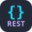
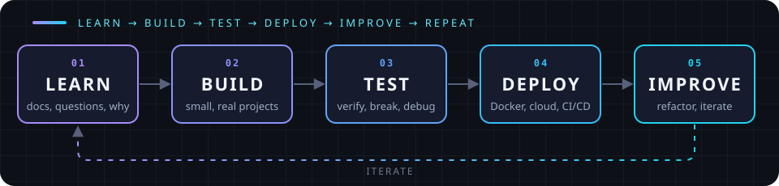

<p align="center">
  
  
</p>

<p align="center">
  <a href="https://linkedin.com/in/amila-pathum-ranasinghe"></a>&nbsp;
  <a href="mailto:amilapathumranasinghe@gmail.com"></a>&nbsp;
  <a href="https://github.com/amila-pathum"></a>
</p>

## About me

I'm **Amila**, an IT undergraduate at the **University of Moratuwa, Sri Lanka**. I like knowing how software works end to end: how a request moves through an API, how the data underneath it is shaped, and what it takes to get the whole thing running somewhere other than my laptop.

Most of what I know comes from building things. I've written backend services in Java and Spring Boot and a few full-stack apps with React and Next.js. Most recently I worked on a [microservices-based delivery project](https://github.com/amila-pathum/swiftdrop/tree/develop) that pulled me into Docker, service boundaries and deployment. Everything else is in my [repositories](https://github.com/amila-pathum?tab=repositories).

<!-- Current focus: edit these three lines as priorities change. -->
```text
backend   →  Java · Spring Boot · REST API design
systems   →  microservices · Docker · PostgreSQL
shipping  →  cloud deployment · CI/CD · Linux
```

## Tech stack

<!--
  Icon tiles: https://skillicons.dev (dark theme). Add one  per technology: i=<id>.
  Tiles skillicons doesn't provide live in assets/icons/ and use the same 48px dark-tile style.
-->
<table align="center">
  <tr>
    <td align="right"><b>Languages</b></td>
    <td>
      
      
      
      
      
    </td>
  </tr>
  <tr>
    <td align="right"><b>Frontend</b></td>
    <td>
      
      
      
      
      
    </td>
  </tr>
  <tr>
    <td align="right"><b>Backend &amp; APIs</b></td>
    <td>
      
      
      
    </td>
  </tr>
  <tr>
    <td align="right"><b>Databases</b></td>
    <td>
      
      
    </td>
  </tr>
  <tr>
    <td align="right"><b>Cloud &amp; DevOps</b></td>
    <td>
      
      
      
      
    </td>
  </tr>
  <tr>
    <td align="right"><b>Tools</b></td>
    <td>
      
      
      
      
      
    </td>
  </tr>
  <tr>
    <td align="right"><b>Systems</b></td>
    <td>
      
      
    </td>
  </tr>
  <tr>
    <td align="right"><b>IoT &amp; Hardware</b><br /><sub>embedded systems</sub></td>
    <td>
      
      
    </td>
  </tr>
</table>

<p align="center"><sub>Tools I've used in coursework and projects. Some I use every day; others I'm still getting comfortable with.</sub></p>

## GitHub statistics

<p align="center">
  <a href="https://github.com/amila-pathum?tab=repositories"></a>
  <a href="https://github.com/amila-pathum?tab=repositories"></a>
</p>

<p align="center"><sub>Live cards fetched from GitHub when you view this page. Nothing here is typed in by hand. Language share reflects repository size, not skill level.</sub></p>

## Contribution activity

<p align="center">
  <a href="https://github.com/amila-pathum#overview"></a>
</p>

<p align="center">
  <a href="https://github.com/amila-pathum#overview"></a>
</p>

<p align="center">
  <picture>
    <source media="(prefers-color-scheme: dark)" srcset="assets/github-contribution-grid-snake-dark.svg" />
    <source media="(prefers-color-scheme: light)" srcset="assets/github-contribution-grid-snake-light.svg" />
    
  </picture>
</p>

<p align="center"><sub>If a card doesn't load, the same data is on my <a href="https://github.com/amila-pathum#overview">profile overview</a>.</sub></p>

## Engineering mindset

<p align="center">
  
</p>

> **Learn by building. Build to understand. Improve with every iteration.**

- **Ubuntu is my daily driver.** Most of my development happens in a terminal on Linux.
- **Small and working beats big and theoretical.** I'd rather ship a small project than read about a big one.
- **Architecture keeps me curious:** where to split services, how they talk, and what happens when one fails.
- **I learn DevOps by doing it:** containerising my own projects and deploying them myself.
- **Software meets hardware:** ESP32 and Arduino projects are where code turns into something physical.

## Currently exploring

<!-- Update the Stage column as things change: practising · learning · next -->
| Area | What I'm working on | Stage |
| :--- | :--- | :---: |
| Java & Spring Boot | Layered services, validation, Spring Data JPA | `practising` |
| REST API design | Resource modelling, status codes, consistent error responses | `practising` |
| Docker | Images and Compose for multi-service local setups | `practising` |
| Microservices | Service boundaries, API gateways, per-service databases | `learning` |
| Database architecture | Schema design, relationships and indexing in PostgreSQL | `learning` |
| Cloud deployment | Running services on AWS and DigitalOcean | `learning` |
| CI/CD & DevOps | Automated builds, tests and deployments with pipelines | `learning` |
| System design | Scalability, caching and the trade-offs between them | `next` |

<sub>`practising`: using it in projects · `learning`: actively studying · `next`: on my list</sub>

## Connect with me

I'm always happy to talk with other students and developers about backend, DevOps, or whatever you're building. Find me on [LinkedIn](https://linkedin.com/in/amila-pathum-ranasinghe) or email [amilapathumranasinghe@gmail.com](mailto:amilapathumranasinghe@gmail.com).

---

<p align="center"><sub>Learn · Build · Test · Deploy · Improve, written on Ubuntu.</sub></p>
