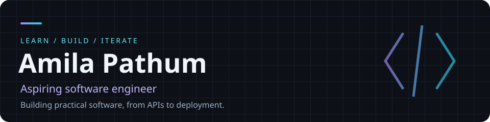

  
  

  <a href="https://linkedin.com/in/amila-pathum-ranasinghe">LinkedIn</a> &nbsp; / &nbsp;
  <a href="mailto:amilapathumranasinghe@gmail.com">Email</a> &nbsp; / &nbsp;
  <a href="https://github.com/amila-pathum?tab=repositories">Repositories</a>

I'm **Amila**, an IT undergraduate at the **University of Moratuwa, Sri Lanka**. I build projects to understand how useful software works—from a clear API and a well-structured database to an application running in the cloud.

## About me

- **Building:** practical backend and full-stack applications while developing my software engineering skills.
- **Learning:** system design, microservices and distributed systems, with Java and Spring Boot at the center.
- **Exploring:** cloud deployment, DevOps and Linux-based development on Ubuntu.

## Current focus

<!-- Edit this table as learning priorities change. -->
| Build the backend | Understand the data | Ship and operate |
| :--- | :--- | :--- |
| Java · Spring Boot | PostgreSQL · database architecture | Docker · containerization |
| Backend engineering · REST APIs | Microservices · service boundaries | Cloud deployment · CI/CD · DevOps |

## Selected projects

<!-- Verified against public source; MemberConnect repositories are forks. -->
<table>
<tr><td>
<h3><a href="https://github.com/amila-pathum/swiftdrop/tree/develop">01 / SwiftDrop</a></h3>

A university courier and delivery management project organized into microservices, with an API gateway and separate service databases. Actively evolving.

<code>Java</code> <code>Spring Boot</code> <code>React</code> <code>PostgreSQL</code> <code>Docker Compose</code>

</td></tr>
<tr><td>
<h3><a href="https://github.com/amila-pathum/swiftdrop/tree/develop/stylecart">02 / StyleCart</a></h3>

A clothing-store application inside SwiftDrop's repository, with a catalogue, cart and orders. Integrates shipment booking and delivery updates; checkout is a demonstration without payments.

<code>Java</code> <code>Spring Boot</code> <code>PostgreSQL</code> <code>REST APIs</code>

</td></tr>
<tr><td>
<h3>03 / MemberConnect</h3>

A membership management application spanning a Spring Boot backend and a Next.js frontend. Linked repositories are my forks of the shared project.

<code>Java</code> <code>Spring Boot</code> <code>PostgreSQL</code> <code>Next.js</code> <code>Tailwind CSS</code>

<a href="https://github.com/amila-pathum/member-connect-backend">Backend fork</a> · <a href="https://github.com/amila-pathum/MemberConnectFrontend">Frontend fork</a>

</td></tr>
<tr><td>
<h3><a href="https://github.com/amila-pathum/library-rest-api">04 / Library REST API</a></h3>

A library API project for practicing Java backend development, with Spring Web MVC, persistence and input validation.

<code>Java</code> <code>Spring Boot</code> <code>Spring Data JPA</code> <code>MySQL</code>

</td></tr>
</table>

## Technologies I work with

A mix of project experience and tools I'm actively learning—not a claim of expertise.

| Area | Technologies |
| :--- | :--- |
| Languages | Java · C · PHP · JavaScript |
| Frontend | React · Next.js · Tailwind CSS |
| Backend | Java · Spring Boot · REST APIs · Node.js fundamentals |
| Databases | PostgreSQL · MySQL |
| Cloud & DevOps | AWS · DigitalOcean · Vercel · Docker · Ubuntu Linux · Git |
| Tools | GitHub · VS Code · IntelliJ IDEA · Figma · Canva |

## GitHub activity

<picture>
  <source media="(prefers-color-scheme: dark)" srcset="assets/github-contribution-grid-snake-dark.svg" />
  <source media="(prefers-color-scheme: light)" srcset="assets/github-contribution-grid-snake-light.svg" />
  
</picture>

[Contributions & profile](https://github.com/amila-pathum#overview) · [Public repositories](https://github.com/amila-pathum?tab=repositories)

Statistics, languages & contribution streak

  
  
  

These optional cards depend on community services and may be unavailable or rate-limited. Language totals reflect repository composition, not proficiency. The profile links above remain available.

---

<em>Build something useful. Understand the tradeoffs. Keep improving.</em> 
Open to connecting with fellow students and developers. 
<a href="mailto:amilapathumranasinghe@gmail.com">amilapathumranasinghe@gmail.com</a>

